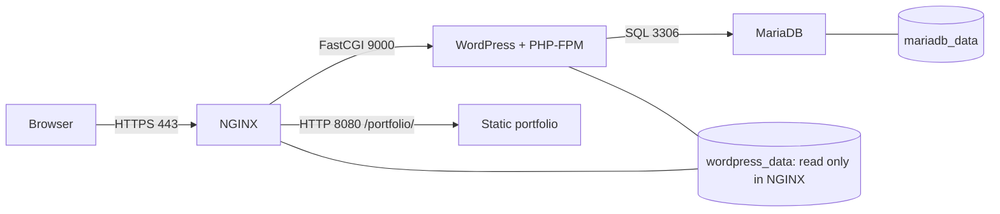

*This project has been created as part of the 42 curriculum by mhasoneh.*

# Inception

## Description

A Linux infrastructure built from four custom Debian images: an HTTPS NGINX
entry point, WordPress with PHP-FPM, MariaDB, and a static portfolio bonus. The
project teaches service isolation, initialization, processes, networking,
secrets, and persistent storage. Final 42 evaluation must run inside a Linux VM.

The implementation follows the complete [local subject, version 5.4](inception_subject.txt).
No separate official evaluation checklist was supplied. Executed checks and
remaining VM checks are recorded in [VALIDATION.md](docs/VALIDATION.md).

## Instructions

Prerequisites: Linux, Git, GNU Make, Bash, OpenSSL, coreutils, util-linux (`flock`),
Docker Engine, and Docker Compose v2.20+. Python 3 and curl are additionally needed
for `make test`. Allow several GB for images and build cache. The Docker daemon
must run on the same host as the checkout and data directories.

Configure name resolution on the machine running your browser. Add
`127.0.0.1 mhasoneh.42.fr` to `/etc/hosts` with administrator authorization for
local development; substitute the reachable VM IP for VM deployment. Installing
Docker and changing hosts files are system prerequisites, not Makefile actions.

```sh
git clone https://github.com/MossaJehad/inception.git
cd inception
make
make ps
make credentials
```

`make` creates missing configuration, four random secrets, and data directories,
then builds and starts every service and waits for healthchecks. It preserves
existing configuration, credentials, and data. Creating host paths may invoke
sudo, using the actual invoking user's UID/GID. Use an account with Docker access.

Open [WordPress](https://mhasoneh.42.fr/), its
[administration panel](https://mhasoneh.42.fr/wp-admin/), or the
[portfolio](https://mhasoneh.42.fr/portfolio/). The self-signed development
certificate requires a browser exception or explicit trust of its public certificate.

The current local rootless Docker installation restricts privileged host port
443. Run `make setup`, edit only the ignored `srcs/.env` to `HTTPS_PORT=8443`,
then run `make`. URLs become `https://mhasoneh.42.fr:8443/`. The committed fresh-clone
and VM default remains **443**. WordPress URLs include the configured port.
See [DEV_DOC.md](DEV_DOC.md) for VM installation and migration instructions.

```sh
make stop       # stop containers
make start      # start stopped containers and wait for health
make down       # remove containers/network; preserve data
make re         # rebuild without cache and restart; preserve data
make test       # isolated fresh-source integration and persistence checks
make help       # aligned command guide and terminal display options
```

`make clean` preserves data. **`make fclean CONFIRM=DELETE` erases this stack's
database, uploads, .env, four secrets, and volume definitions.** Back up first.
No normal target prunes Docker or deletes persistent data.

## Project description



| Service / image | Purpose | Persistent storage |
| --- | --- | --- |
| `nginx` / `nginx:inception` | TLS 1.2/1.3, static assets, FastCGI, portfolio proxy | WordPress files, read only |
| `wordpress` / `wordpress:inception` | WordPress 7.1.3, PHP 8.2 FPM, WP-CLI 2.12.0 | `wordpress_data` |
| `mariadb` / `mariadb:inception` | MariaDB 10.11 from Debian security packages | `mariadb_data` |
| `static_site` / `static_site:inception` | BusyBox HTTP server; HTML, CSS, JavaScript | None |

Every service has a Dockerfile based on `debian:12.15-slim`. Debian 13 is current
stable and Debian 12 is the penultimate stable release, checked on 2026-10-28
against [Debian's release index](https://www.debian.org/releases/). Recheck before
a later evaluation. Application packages come from Debian repositories;
WordPress and WP-CLI downloads use fixed versions and verified SHA-256 checksums.
No prebuilt application image is pulled.

All services explicitly join the `inception` bridge. Only NGINX publishes a host
port. Docker DNS resolves internal service names. Mandatory daemons run as PID 1; the static HTTP server uses Docker tiny init
to forward signals and reap children. `unless-stopped` handles process crashes;
healthchecks gate initial dependency startup and `make` waits for readiness.

Two Docker named volumes, `mariadb_data` and `wordpress_data`, use the local driver
with `type: none`, `o: bind`, and host devices `/home/mhasoneh/data/mariadb` and
`/home/mhasoneh/data/wordpress`. Service data mounts have type `volume`. The local
driver performs a bind operation internally to meet the subject's host-location
requirement; these are not direct service bind mounts. `DATA_DIR` and
`VOLUME_PREFIX` allow disposable test isolation; their defaults meet the subject.

### Automatic configuration and credentials

`make setup` copies the non-sensitive `srcs/.env.example` only when `.env` is
absent. Host scripts read configuration as data, never as shell code. Missing
secrets use `openssl rand -hex 32`: 256 bits of randomness each. `secrets/` is
mode 700; its files and `.env` are mode 600. Setup serializes concurrent calls,
validates settings, preserves values, and refuses to replace missing credentials
beside populated data.

Compose grants each service only its needed secret files. PHP bootstrap reads
account passwords inside the process, avoiding command arguments and prompt
logging. The database password is copied to a protected runtime file outside the
shared document root; persistent `wp-config.php` contains no database password.
Random authentication salts persist under the protected `.inception/` directory.

`make credentials` shows URL, username, and private password-file location.
Read `secrets/wp_admin_password.txt` explicitly in a private terminal to log in.
Administrator `mhasoneh` and editor `editor42` have distinct generated passwords.
Emails use reserved `example.invalid` placeholders; no personal address or SMTP
service is invented. Set real email addresses before initialization if needed.

### Virtual Machines vs Docker

A VM runs a guest kernel and operating system. Containers isolate processes while
sharing the host kernel, making services smaller and faster to recreate. The VM
is the evaluation host; the four containers run inside it.

### Secrets vs Environment Variables

Environment variables configure names, URLs, and other non-sensitive settings;
they can appear in inspection output. Secrets provide restricted files to chosen
containers. Standalone Compose file secrets are local mounts, **not encrypted
Swarm storage**. Host permissions and private backups still matter.

### Docker Network vs Host Network

A user-defined bridge provides service DNS and separation with explicitly
published host ports. Host networking shares the host network namespace. This
stack uses bridge networking and does not use host mode or legacy links.

### Docker Volumes vs Bind Mounts

A named volume has Docker-managed identity and persists independently of
containers. A direct bind mount maps a host path directly into a service. Here,
named volumes use the local driver's host-path options for the two required
storages. Deleting a local-driver volume definition alone does **not** erase its
host-directory contents; `fclean` explicitly erases those contents first.

## Static website bonus

The sole bonus is a responsive portfolio at `/portfolio/`, served by a separate
BusyBox HTTP container. It presents the learner's login, tools practiced here,
the real Inception project, and the existing GitHub profile. It uses no PHP,
framework, invented employment, or fabricated projects. Its HTML, CSS, and
JavaScript pass through the existing HTTPS entry point. No other bonus is included.

## Resources

- [Local subject](inception_subject.txt)
- [Docker Engine installation](https://docs.docker.com/engine/install/)
- [Compose reference](https://docs.docker.com/reference/compose-file/)
- [Docker volumes](https://docs.docker.com/engine/storage/volumes/)
- [Compose secrets](https://docs.docker.com/compose/how-tos/use-secrets/)
- [Debian releases](https://www.debian.org/releases/)
- [MariaDB initialization](https://mariadb.com/docs/server/clients-and-utilities/deployment-tools/mariadb-install-db)
- [PHP-FPM configuration](https://www.php.net/manual/en/install.fpm.configuration.php)
- [NGINX FastCGI](https://nginx.org/en/docs/http/ngx_http_fastcgi_module.html)
- [NGINX TLS](https://nginx.org/en/docs/http/ngx_http_ssl_module.html)
- [WordPress releases](https://wordpress.org/download/releases/) and [WP-CLI](https://wp-cli.org/)

### AI usage

Codex assisted with inspection, implementation of Dockerfiles, configuration,
initialization scripts, portfolio, automated tests, security review, and
documentation. Correct earlier scaffold work was preserved. The learner must
review, understand, and explain every submitted file. Executed results and limits
are disclosed in [VALIDATION.md](docs/VALIDATION.md); generated code alone is not
evidence that an unexecuted VM check passed.

See the [documentation index](docs/README.md), [security policy](SECURITY.md), and
[MIT license](LICENSE). The subject and third-party software retain their terms.
